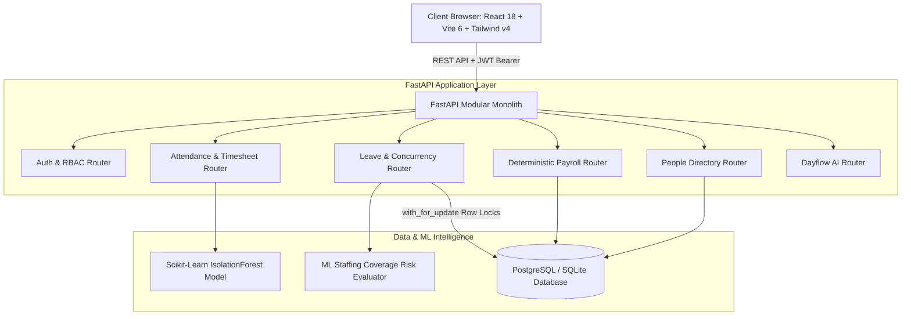

# ⚡ Dayflow HRMS — Modern Workforce Operations Monolith

<div align="center">


**Every workday, perfectly aligned.**  
An autonomous, auditable, and modular Human Resource Management System combining **Timezone-Aware UTC Attendance**, **ML Staffing Coverage Risk**, **Unsupervised IsolationForest Anomaly Detection**, **Deterministic Calendar-Day Payroll Proration**, and a **Live Database-Context AI Assistant**.

[Live Demo](#-quick-demo-accounts) • [Architecture](#-architecture) • [Features](#-core-features) • [Installation](#-quick-start) • [Credentials](LOGIN_CREDENTIALS.md)

</div>

---

## 📖 Overview & Core Philosophy

Traditional HRMS platforms suffer from fragmented microservices, leave-approval race conditions, and opaque, dispute-prone payroll calculations. **Dayflow** reimagines workforce management as a lean, high-integrity modular monolith:

1. ⏱️ **Zero-Drift Attendance**: UTC-normalized timestamps coupled with immutable client IANA timezone snapshots (`America/New_York`, `Asia/Kolkata`, `Europe/London`).
2. 🌴 **ML Staffing Coverage Risk**: Real-time evaluation of concurrent team availability before leave submission (`GREEN`, `AMBER`, `RED` risk tiers).
3. 🚨 **Unsupervised ML Anomaly Detection**: An active `IsolationForest` engine scoring shift vectors for overtime (>14.5 hrs), abnormal arrival times, and weekend logging.
4. 💵 **Deterministic Calendar-Day Payroll Proration**: Mathematically provable, inclusive calendar-day earnings formulas with 1-click printable PDF Pay Slips.
5. 🤖 **Dayflow AI Copilot**: Context-aware operations assistant with dynamic user session context injection.

---

## 🏛️ System Architecture



---

## ✨ Core Features

### 1. 👤 Employee Self-Service Desk
- **Today Pulse Card**: 1-click real-time check-in and check-out with client IANA timezone capture.
- **Weekly Timesheets (Mon–Sun)**: Automated shift classifications:
  - 🟢 `Present` (>7.5h full shift)
  - 🟡 `Half-day` (<4h partial shift)
  - 🔴 `Absent` (unlogged weekday)
  - 🟣 `On Leave` (approved time off)
- **Time Away (Leave)**: Real-time quota balance rings with instant ML staffing coverage risk badges.
- **Document Vault**: Upload, preview, and download verified employee files (*Contracts*, *Tax W-4*, *IDs*, *Certificates*).
- **Itemized Payslips**: Transparent proration breakdowns with 1-click **Print / Save PDF**.

### 2. 👑 HR Operations Control Room
- **Health Monitor**: Organization-wide attendance matrix and pending queues.
- **Concurrency-Safe Approval Desk**: Database row-level locking (`with_for_update`) ensuring zero double-spending of leave with mandatory audit comments.
- **ML Anomaly Alert Inbox**: Real-time review and 1-click resolution of IsolationForest outliers.
- **People Directory & Onboarding Wizard**: Single-step provisioning for new hires with auto-configured credentials, department, and salary structures.
- **Executive HR Analytics**: Interactive Recharts visualizations for attendance velocity, departmental salary allocations, and leave burn-down.

### 3. 🤖 Dayflow AI Copilot
- **Live User Context**: Dynamically pulls active session data (name, role, today's attendance status, remaining leave balances).
- **Concise & Actionable**: Answers questions in crisp, structured bullet points without generic boilerplate.
- **Zero-Friction**: Floating widget available across all screens with dark mode compatibility.

---

## 🔑 Quick Demo Accounts

Pre-seeded credentials for instant demonstration:

| Role | Name | Email | Password | Key Demo Scenario |
|---|---|---|---|---|
| **HR Operations Admin** | Sarah Jenkins | `admin@dayflow.com` | `Admin@1234` | Health Monitor, Leave Approvals, Anomaly Inbox, People Directory, Payroll Desk. |
| **Senior Engineering Lead** | Alice Chen | `alice@dayflow.com` | `Alice@1234` | Employee Desk, Check-in/out, Weekly Timesheets, 17 days balance. |
| **Mid-Month Joiner** | Bob Okafor | `bob@dayflow.com` | `Bob@1234` | **Payroll Proration**: Joined Aug 15 ($17/31 = 0.5484$ factor), PDF Pay Slip. |
| **People Specialist** | Clara Vance | `clara@dayflow.com` | `Clara@1234` | **ML Late Arrival Anomaly**: London timezone, flagged in Alert Inbox. |
| **DevOps Lead** | David Kim | `david@dayflow.com` | `David@1234` | **ML Overtime & RED Conflict**: 14.5h overtime, concurrent leave conflict. |

---

## 🚀 Quick Start

### Prerequisites
- **Python**: 3.11+
- **Node.js**: 18+ & npm

### 1. Clone & Setup Backend
```bash
git clone https://github.com/cheenu-exe/dayflow.odoo.git
cd dayflow.odoo/backend

# Create virtual environment
python -m venv .venv
source .venv/bin/activate   # On Windows: .\.venv\Scripts\activate

# Install dependencies
pip install -r requirements.txt

# Seed the curated database and train ML model
python seed.py

# Start the FastAPI Server
uvicorn app.main:app --host 0.0.0.0 --port 8000 --reload
```
*Backend runs on: `http://localhost:8000` (API Docs: `http://localhost:8000/docs`)*

### 2. Setup Frontend
```bash
cd ../frontend

# Install dependencies
npm install

# Start Vite Development Server
npm run dev
```
*Frontend runs on: `http://localhost:5173`*

---

## 📐 Mathematical & Domain Specifications

### 1. Deterministic Inclusive Calendar-Day Proration
$$\text{Eligible Days} = (\text{Total Days in Month} - \text{Join Day} + 1)$$
$$\text{Proration Factor} = \frac{\text{Eligible Days}}{\text{Total Days in Month}}$$
$$\text{Gross Payout} = \text{Proration Factor} \times (\text{Basic} + \text{Housing} + \text{Transport})$$

### 2. ML Staffing Coverage Risk Tiers
- 🟢 **GREEN**: Concurrent team leave overlap $< 50\%$.
- 🟡 **AMBER**: Concurrent team leave overlap $50\% - 70\%$.
- 🔴 **RED**: Concurrent team leave overlap $> 70\%$ or simultaneous absence of key leads.

---

## 🔒 Security & Data Integrity
- **Password Security**: Salted Bcrypt hashing (`cost: 12`).
- **Authorization**: Role-Based Access Control (`HR_ADMIN` vs `EMPLOYEE`) enforced at dependency injection layer.
- **Race Condition Immunity**: Row-level locking on balance deductions via `select(...).with_for_update()`.
- **Client Timezone Snapshots**: Full IANA timezone capture accompanying UTC timestamps.

---

## 📄 License
Licensed under the [MIT License](LICENSE).
